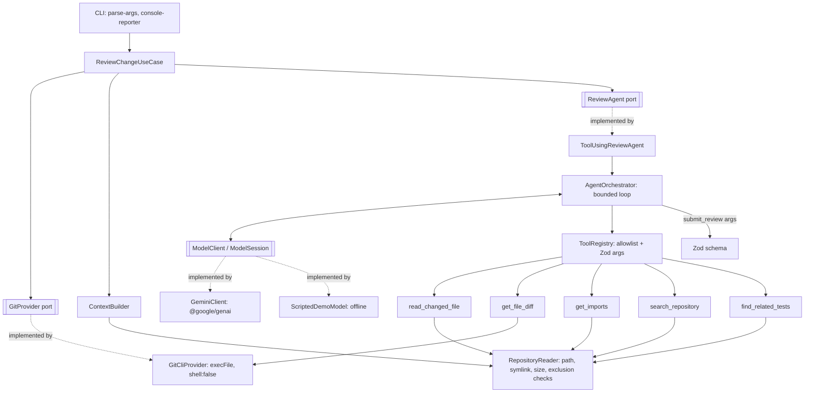

# DiffSentinel architecture

A small modular layered design inspired by Ports and Adapters. Everything runs in one CLI process.

## Review sequence

1. Use case asks Git for a manifest (staged + unstaged vs HEAD, plus untracked non-ignored files).
2. ContextBuilder drops excluded/binary files, fetches per-file diffs within budget, redacts secret-like values, records skipped files and partial coverage.
3. The agent opens a model session with the system prompt, the five tool declarations and `submit_review`.
4. Loop (max 6 turns / 10 tool calls / 4 per turn, or fewer with `--max-calls`): model returns function calls (often several in parallel) → registry validates and executes → results go back with a budget notice before the last turn → on the last turn the model is forced to call `submit_review` → Zod validation (one repair). Each call is recorded in the trace.
5. The use case adds deterministic fields (overall risk, coverage, warnings, ids) and the CLI renders text and/or JSON.

## Security boundaries (what actually protects the user)

Prompt wording is **not** a boundary. The boundaries are code:

| Boundary | Where |
|---|---|
| Model can only name registered tools; args validated | `tool-registry.ts` |
| No shell, no arbitrary file read; only fixed git commands | `git-cli.provider.ts`, tools |
| Path allowlist, `..`/absolute/NUL rejection, symlink and root check, exclusion re-check on the resolved target | `repository-reader.ts` |
| Secrets/lockfiles/binaries never read or diffed | `exclusions.ts`, `context-builder.ts` |
| Hard caps on iterations, tool calls, bytes, characters | `config/limits.ts`, `agent-orchestrator.ts` |
| Repository is never modified | no write path exists in the reviewer |

Dependency direction: CLI → application → domain; adapters implement the ports. Pragmatic exceptions: the application layer imports the filesystem reader and exclusion rules directly (no Gemini or child-process details leak into it).
